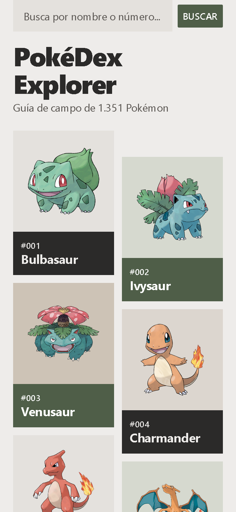
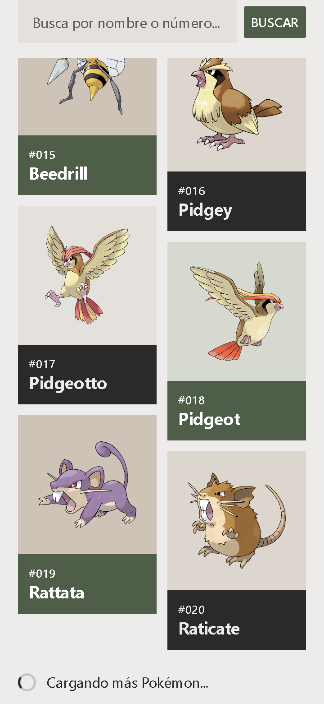
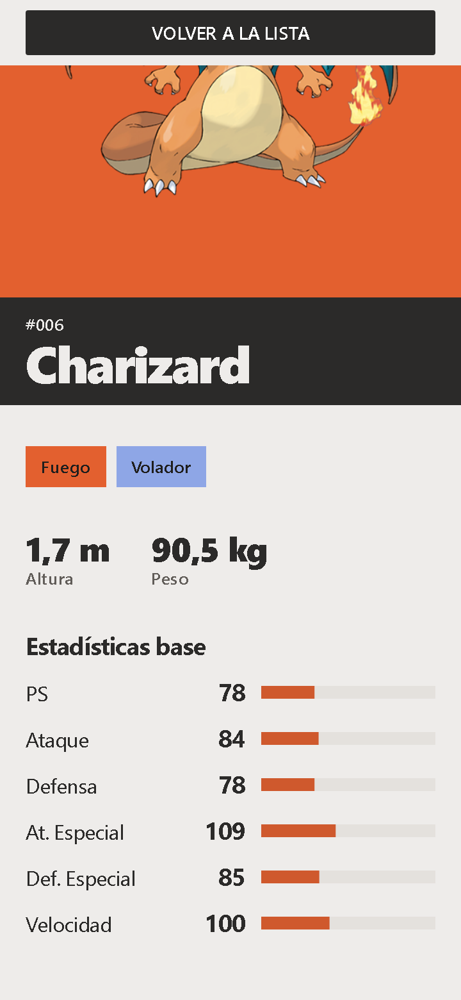
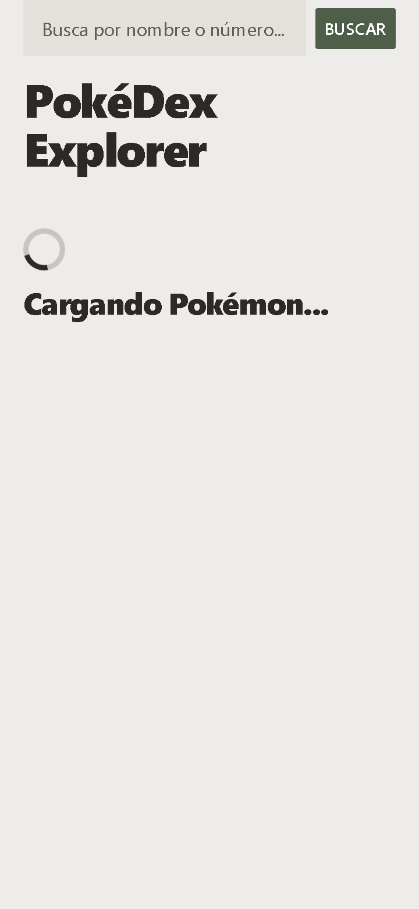
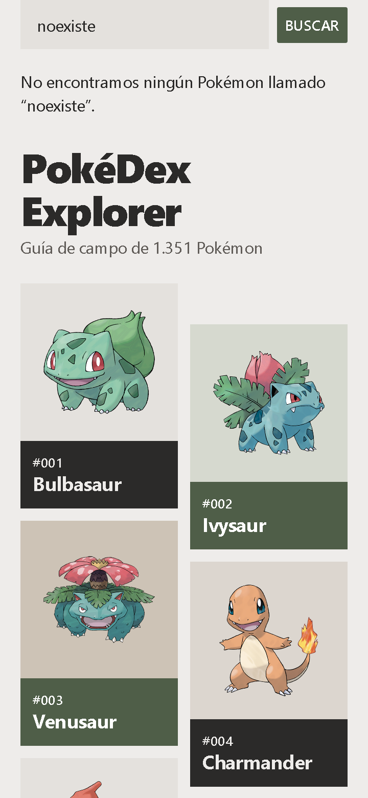
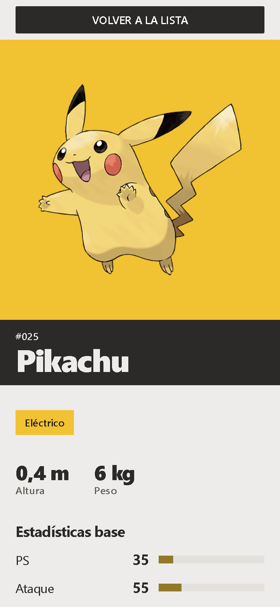
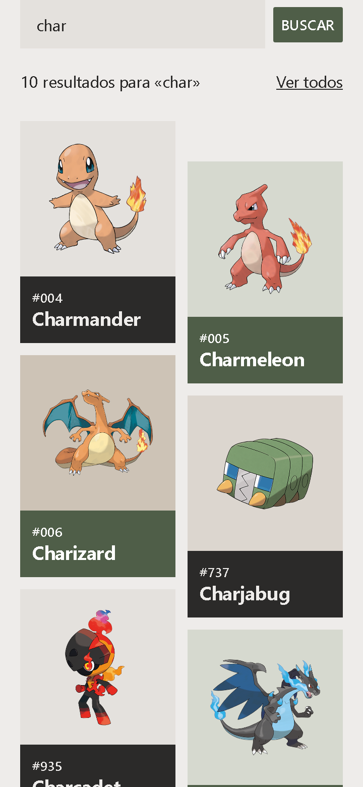

# PokéDex Explorer

App móvil hecha con **React Native + Expo (SDK 57)** que consume la [PokéAPI](https://pokeapi.co). Muestra el catálogo de Pokémon en una lista paginada con scroll infinito, permite buscar por nombre o por número y abre la ficha de cada uno con su imagen, sus tipos, sus medidas y sus estadísticas base.

- **Materia:** Taller de Consumo de API con React Native y Expo
- **Universidad:** TdeA (Tecnológico de Antioquia)
- **Integrantes:**
  - Anderson de Jesús Londoño Avendaño

---

## Cómo ejecutar

**Requisitos previos**

- Node.js LTS (20 o superior, con npm).
- La app **Expo Go** instalada en el teléfono (Android o iOS), en una versión compatible con el SDK 57.
- El teléfono y el computador en la misma red Wi-Fi. Si la red no deja conectar, usa `npx expo start --tunnel`.

**Pasos**

```bash
npm install        # instala las dependencias de package.json
npx expo start     # arranca el servidor de desarrollo y muestra un código QR
```

1. Escanea el código QR con Expo Go (en Android, desde la propia app; en iOS, con la cámara).
2. Para usar un emulador, con el servidor abierto presiona `a` (Android) o `i` (iOS).

No hace falta ninguna clave: la PokéAPI es pública. La app necesita conexión a internet.

## Funcionalidades

- **Lista paginada de 20 en 20** en una cuadrícula de dos columnas, con **scroll infinito**: al acercarse al final se pide la siguiente página, sin repetir peticiones ni duplicar Pokémon.
- **Ficha de cada Pokémon**: imagen oficial, número de catálogo (`#025`), tipos, altura, peso y las seis estadísticas base con su barra.
- **Búsqueda por nombre o por número**: con 2 o más letras (en inglés, como las entrega la PokéAPI) se buscan coincidencias parciales por nombre. Si hay varias, se muestra una lista de hasta 100 resultados con "Ver todos" para volver a la lista completa; si hay una sola coincidencia o el nombre exacto, se abre su ficha. El número y las búsquedas de una sola letra son exactas. Las mayúsculas y los espacios se normalizan (`Pikachu`, `  025 `) y los espacios interiores pasan a guion (`mr mime`). El índice de nombres se pide una sola vez, la primera vez que se busca texto, y se guarda en memoria durante la sesión. Un término sin resultados muestra el mensaje con el término. Se lanza con el botón o con la tecla de enviar del teclado.
- **Estados de carga, error y sin resultados** en todas las pantallas: cada petición muestra un texto en español, nunca un código técnico, y los errores ofrecen un botón para reintentar. Si falla una página intermedia de la lista, los Pokémon ya cargados se conservan.
- **Botón Atrás de Android**: desde la ficha vuelve a la lista (no cierra la app) y la lista conserva su posición.
- **Accesibilidad**: etiquetas y roles en lo interactivo, texto que crece con el tamaño de fuente del sistema y respeto del ajuste "Reducir movimiento".

## Tecnologías

- Expo SDK 57 y React Native, con JavaScript.
- `react-native-safe-area-context` para las áreas seguras.
- La PokéAPI como fuente de datos.
- Sin axios ni librerías de navegación.

## Capturas de la interfaz (360×780)

Capturas en el navegador a 360×780, con datos de la PokéAPI simulados.

| | |
|---|---|
|  |  |
| Lista inicial | Carga de más Pokémon |
|  |  |
| Ficha de Charizard | Cargando la lista |
|  |  |
| Error con Reintentar | Búsqueda sin resultados |
|  |  |
| Ficha tras buscar "Pikachu" | Resultados de buscar «char» |

## Árbol de carpetas

```
.
├── App.js
├── index.js
├── .gitignore
├── app.json
├── package.json
├── package-lock.json
├── README.md
├── LICENSE
├── assets/
│   ├── android-icon-background.png
│   ├── android-icon-foreground.png
│   ├── android-icon-monochrome.png
│   ├── favicon.png
│   ├── icon.png
│   └── splash-icon.png
├── screenshots/
│   ├── 01-lista.png
│   ├── 02-cargando-mas.png
│   ├── 03-ficha.png
│   ├── 04-cargando.png
│   ├── 05-error.png
│   ├── 06-sin-resultados.png
│   ├── 07-busqueda.png
│   └── 08-resultados-busqueda.png
└── src/
    ├── components/
    │   ├── EmptyState.js
    │   ├── ErrorState.js
    │   ├── Header.js
    │   ├── ListFooter.js
    │   ├── LoadingState.js
    │   ├── PokemonCard.js
    │   ├── SearchBar.js
    │   ├── SearchResultsHeader.js
    │   ├── StatBar.js
    │   └── TypeBadge.js
    ├── config/
    │   ├── api.js
    │   ├── labels.js
    │   └── strings.js
    ├── hooks/
    │   ├── usePokemonDetail.js
    │   ├── usePokemonList.js
    │   ├── usePokemonSearch.js
    │   └── useReduceMotion.js
    ├── screens/
    │   ├── HomeScreen.js
    │   ├── PokemonDetailView.js
    │   └── PokemonListView.js
    ├── services/
    │   ├── apiErrors.js
    │   └── pokemonService.js
    ├── theme/
    │   ├── colors.js
    │   ├── index.js
    │   ├── motion.js
    │   ├── spacing.js
    │   ├── typeColors.js
    │   └── typography.js
    └── utils/
        ├── formatters.js
        ├── nameFit.js
        └── searchMatch.js
```

## Responsabilidad de cada archivo

### Raíz

| Archivo | Responsabilidad |
|---|---|
| `index.js` | Punto de entrada: registra `App` como componente raíz de Expo. |
| `App.js` | Raíz de la app: provee las áreas seguras (`SafeAreaProvider`, `SafeAreaView`), pinta el fondo piedra y la barra de estado, y muestra `HomeScreen`. No tiene lógica. |
| `app.json` | Configuración de Expo: nombre de la app, orientación, fondo claro e iconos. |
| `package.json` | Dependencias (solo cinco) y scripts de arranque. |
| `screenshots/` | Las ocho capturas de la interfaz (`01-lista.png` a `08-resultados-busqueda.png`) que se muestran en este README. |

### `src/screens/`

| Archivo | Responsabilidad |
|---|---|
| `HomeScreen.js` | Única pantalla: guarda con estado qué Pokémon está abierto (`null` es la lista) y alterna entre lista y ficha sin librería de navegación; mantiene la lista montada para no perder su posición. |
| `PokemonListView.js` | Vista de la lista: cuadrícula `FlatList` de dos columnas con scroll infinito, encabezado, campo de búsqueda fijo, y los estados de carga, error, pie de página y sin resultados. Cuando una búsqueda da varias coincidencias, muestra su lista de resultados sobre la lista principal, que sigue montada. |
| `PokemonDetailView.js` | Vista de la ficha: barra con "volver", campo de color con la imagen y su revelado, debajo una etiqueta de tinta a sangre con el número y el nombre, y luego tipos, medidas y estadísticas; maneja el botón Atrás de Android con `BackHandler`. |

### `src/components/`

| Archivo | Responsabilidad |
|---|---|
| `PokemonCard.js` | Pieza de la cuadrícula: cuadro con la imagen y, pegada debajo, la etiqueta con número y nombre; toda la pieza es el área táctil. |
| `SearchBar.js` | Campo de texto controlado y botón "Buscar"; cierra el teclado al enviar y avisa al padre. |
| `SearchResultsHeader.js` | Línea de resultados («10 resultados para «char»») y acción "Ver todos". |
| `Header.js` | Título de la app y subtítulo con el total del catálogo. |
| `StatBar.js` | Una fila de estadística: nombre, valor numérico y barra proporcional a 255 que crece animada. |
| `TypeBadge.js` | Rectángulo con el nombre del tipo en español y su color. |
| `LoadingState.js` | Bloque de carga: indicador junto a un texto visible. |
| `ErrorState.js` | Bloque de error: frase en español y botón "Reintentar", que es opcional. |
| `EmptyState.js` | Bloque de "sin resultados" con la frase que nombra lo buscado. |
| `ListFooter.js` | Pie de la lista: muestra la carga o el error de la página siguiente. |

### `src/hooks/`

| Archivo | Responsabilidad |
|---|---|
| `usePokemonList.js` | Estado de la lista paginada: primera página, páginas siguientes, reintento, sin duplicados y parada cuando no hay más. |
| `usePokemonDetail.js` | Carga un Pokémon por id y expone su estado (`loading`, `success`, `error`) y su reintento. |
| `usePokemonSearch.js` | Búsqueda exacta o parcial: normaliza el término, cancela la búsqueda anterior, guarda el índice de nombres en memoria durante la sesión y traduce el resultado a un estado (`idle`, `loading`, `empty`, `error`) o a una lista de resultados. |
| `useReduceMotion.js` | Informa si el sistema tiene activado "Reducir movimiento" y se actualiza si cambia. |

### `src/services/`

| Archivo | Responsabilidad |
|---|---|
| `pokemonService.js` | Único módulo que llama a la red: `fetch` con `response.ok`, página de la lista, detalle por id o nombre, índice de nombres, y conversión del JSON de la API a modelos limpios. |
| `apiErrors.js` | Errores tipados (`NotFoundError`, `HttpError`) y la comprobación de cancelación (`isAbortError`). |

### `src/config/`

| Archivo | Responsabilidad |
|---|---|
| `api.js` | URL base de la API, tamaño de página (20), máximo de una estadística (255), tamaño del índice de nombres, máximo de resultados (100) y construcción de la URL de la imagen. |
| `strings.js` | Todos los textos de la interfaz, en español, incluidos los de los resultados de búsqueda. |
| `labels.js` | Nombres en español de los 18 tipos y de las 6 estadísticas. |

### `src/theme/`

| Archivo | Responsabilidad |
|---|---|
| `index.js` | Punto de entrada único de los valores de diseño. |
| `colors.js` | Paleta base y los cuatro pares color de pieza / color de etiqueta de la cuadrícula. |
| `typeColors.js` | Color de fondo, de texto y de barra para cada uno de los 18 tipos. |
| `typography.js` | Los cinco estilos de texto y las cifras tabulares. |
| `spacing.js` | Escala de espaciado y medidas de los componentes. |
| `motion.js` | Duraciones y curva de las animaciones de la ficha. |

### `src/utils/`

| Archivo | Responsabilidad |
|---|---|
| `formatters.js` | Funciones puras de formato y conversión: número `#025`, mayúscula inicial, id desde una URL, normalización del término buscado, unidades y formato numérico es-CO. |
| `searchMatch.js` | Decide si el término es exacto o parcial, y ordena las coincidencias (nombre exacto, empieza por el término, lo contiene). |
| `nameFit.js` | Elige el tamaño de letra del nombre en la ficha para que un nombre largo nunca pase de dos líneas. |

## Arquitectura

```
screens  ──►  hooks  ──►  services  ──►  PokéAPI
(vistas)     (estado)     (red)         (https://pokeapi.co)
```

- **`screens` y `components`** dibujan y reciben eventos. Nunca llaman a `fetch` ni conocen la forma del JSON de la API.
- **`hooks`** guardan el estado de cada petición (`status`, datos) y llaman a los servicios. Reducen cualquier fallo a un estado: ningún mensaje de error, código HTTP ni texto en inglés llega a la pantalla; la vista elige su propio texto en español.
- **`services`** son el único lugar donde existe `fetch`. Comprueban `response.ok` antes de leer el cuerpo, lanzan errores tipados y devuelven modelos limpios.

**Por qué la red está separada de la interfaz**

- **Pruebas más simples:** el servicio y las funciones de `utils` son funciones puras o asíncronas sin dependencia de React, así que se pueden comprobar solas.
- **Cancelación con `AbortController`:** cada petición pertenece a un hook, que aborta el `fetch` al salir de la pantalla o al empezar una búsqueda nueva. Una respuesta tardía nunca pisa a una más reciente ni actualiza una vista que ya no existe.
- **Errores traducidos a estados:** cancelar no es fallar (se ignora), en la búsqueda un 400 o un 404 significan "sin resultados" (por ejemplo, un término que la API no puede interpretar, como `pikachu?`, o un nombre que no existe) y cualquier otro fallo (sin red, error 5xx, 429) es un error con el botón Reintentar. Esa decisión se toma en un solo lugar.
- **Una sola dependencia de la API:** si cambia el JSON o la URL, solo se toca `pokemonService.js` y `api.js`.

**Navegación sin librería.** No se usa Expo Router ni React Navigation. `HomeScreen` guarda en un estado el id del Pokémon abierto: `null` muestra la lista y un número muestra la ficha. La lista sigue montada debajo de la ficha, por lo que al volver conserva su posición y no repite la petición. En Android, `BackHandler` intercepta el botón Atrás de la ficha y vuelve a la lista.

**Dependencias.** Solo las cinco del proyecto, todas instaladas con la versión que fija el SDK 57:

| Paquete | Para qué |
|---|---|
| `expo` | Plataforma y herramientas de Expo. |
| `expo-status-bar` | Barra de estado. |
| `react` | Biblioteca de interfaces. |
| `react-native` | Componentes nativos, `fetch`, `Animated`, `BackHandler`. |
| `react-native-safe-area-context` | Áreas seguras reales en Android e iOS (el `SafeAreaView` del núcleo está obsoleto). |

## Índice de conceptos

Cada concepto visto en clase está marcado en el código con un comentario `// [CONCEPT] nombre: por qué se usa aquí`. Para encontrarlos todos: `grep -rn "\[CONCEPT\]" App.js src`.

| Concepto | Dónde |
|---|---|
| `View` | `src/screens/HomeScreen.js` |
| `Text` | `src/components/Header.js` |
| `TextInput` | `src/components/SearchBar.js` |
| `Button` | `src/components/ErrorState.js` |
| `Image` | `src/components/PokemonCard.js` |
| `StyleSheet` | `App.js` |
| `SafeAreaView` | `App.js` |
| `useState` | `src/screens/HomeScreen.js`, `src/screens/PokemonListView.js`, `src/screens/PokemonDetailView.js`, `src/hooks/usePokemonList.js`, `src/hooks/usePokemonDetail.js`, `src/hooks/usePokemonSearch.js`, `src/hooks/useReduceMotion.js` |
| `useEffect` | `src/hooks/usePokemonList.js`, `src/hooks/usePokemonDetail.js`, `src/hooks/useReduceMotion.js`, `src/components/StatBar.js`, `src/screens/PokemonDetailView.js` |
| `fetch` | `src/services/pokemonService.js` |
| `async/await` | `src/services/pokemonService.js`, `src/hooks/usePokemonList.js`, `src/hooks/usePokemonDetail.js`, `src/hooks/usePokemonSearch.js` |
| `response.ok` | `src/services/pokemonService.js` |
| `FlatList` | `src/screens/PokemonListView.js` |
| `numColumns` | `src/screens/PokemonListView.js` |
| `keyExtractor` | `src/screens/PokemonListView.js` |
| `onEndReached` | `src/screens/PokemonListView.js` |
| `AbortController` | `src/services/pokemonService.js`, `src/hooks/usePokemonList.js`, `src/hooks/usePokemonDetail.js`, `src/hooks/usePokemonSearch.js` |
| `encodeURIComponent` | `src/services/pokemonService.js` |
| `padStart` | `src/utils/formatters.js` |
| `props` | `src/components/LoadingState.js`, `src/components/ListFooter.js`, `src/components/StatBar.js`, `src/components/TypeBadge.js`, `src/components/SearchResultsHeader.js` |
| `React.memo` | `src/components/PokemonCard.js` |
| `useCallback` | `src/screens/HomeScreen.js` |
| `useRef` | `src/screens/PokemonListView.js`, `src/screens/PokemonDetailView.js`, `src/components/StatBar.js`, `src/hooks/usePokemonSearch.js` |
| `useWindowDimensions` | `src/screens/PokemonListView.js`, `src/screens/PokemonDetailView.js` |
| `Animated` | `src/components/StatBar.js`, `src/screens/PokemonDetailView.js` |
| `ScrollView` | `src/screens/PokemonDetailView.js` |
| `Keyboard` | `src/components/SearchBar.js` |
| Campo controlado (`controlled input`) | `src/components/SearchBar.js` |
| Limpieza de `useEffect` (`useEffect cleanup`) | `src/hooks/usePokemonSearch.js` |

## Diseño

### La idea

La interfaz es un **catálogo de especímenes**, una guía de campo. Cada Pokémon aparece solo, sobre un campo de color plano, con una **etiqueta colgante** pegada debajo que lleva su número y su nombre (en la lista alterna entre tinta y acento; en la ficha es siempre de tinta), como la ficha de un ejemplar en una colección. No hay tarjetas con sombra, ni degradados, ni adornos: todo elemento en pantalla es un dato o un control. El color saturado vive únicamente en los datos (la imagen y el color de cada tipo); todo lo demás es neutro.

### Paleta

Colores neutros cálidos, con una tinta ligeramente teñida y un único acento verde salvia.

| Rol | Nombre | Hex |
|---|---|---|
| Fondo de la app | Piedra (`ground`) | `#EEECEA` |
| Texto principal y etiquetas oscuras | Tinta (`ink`) | `#2B2A29` |
| Texto secundario | Tinta atenuada (`inkMuted`) | `#615D59` |
| Botones y etiquetas verdes | Acento (`accent`) | `#4F5E48` |
| Texto sobre etiqueta de tinta | `onInk` | `#EEECEA` |
| Texto sobre etiqueta de acento | `onAccent` | `#FFFFFF` |
| Superficie: campo de búsqueda, pista de la barra, pieza A | `surface` | `#E4E1DD` |
| Pieza B | `sage` | `#D6D9CF` |
| Pieza C | `field` | `#CDC3B6` |
| Pieza D | `stone4` | `#DCD6CF` |

Las piezas de la cuadrícula rotan entre cuatro pares de fondo y etiqueta (A: `#E4E1DD` con tinta, B: `#D6D9CF` con acento, C: `#CDC3B6` con acento, D: `#DCD6CF` con tinta), de modo que ninguna pieza vecina, ni al lado ni encima, repite color. Al mantener presionada una pieza, su fondo pasa a un tono un paso más oscuro (`#D5D2CF`, `#C8CBC2`, `#C0B7AB`, `#CEC8C2`).

**Color por tipo.** Cada uno de los 18 tipos tiene su propio color plano, con texto oscuro (`#1F1E1D`) o claro (`#FFFFFF`) elegido para lograr un contraste de al menos 4,5:1, y un tono de barra algo más oscuro cuando hace falta para que la barra de estadística destaque (al menos 3:1) sobre su pista:

| Tipo | Fondo | Texto | | Tipo | Fondo | Texto |
|---|---|---|---|---|---|---|
| Normal | `#A9A399` | `#1F1E1D` | | Roca | `#AE9650` | `#1F1E1D` |
| Fuego | `#E3602F` | `#1F1E1D` | | Fantasma | `#584A86` | `#FFFFFF` |
| Agua | `#2F6DC6` | `#FFFFFF` | | Dragón | `#4458C8` | `#FFFFFF` |
| Eléctrico | `#F1C232` | `#1F1E1D` | | Siniestro | `#4A3F38` | `#FFFFFF` |
| Planta | `#4F9A4A` | `#1F1E1D` | | Acero | `#8EA1AE` | `#1F1E1D` |
| Hielo | `#86CFD6` | `#1F1E1D` | | Hada | `#E9A2C6` | `#1F1E1D` |
| Lucha | `#B83C2C` | `#FFFFFF` | | Veneno | `#8E4A9C` | `#FFFFFF` |
| Tierra | `#CFA25A` | `#1F1E1D` | | Volador | `#8EA6E6` | `#1F1E1D` |
| Psíquico | `#E2557F` | `#1F1E1D` | | Bicho | `#93AE2E` | `#1F1E1D` |

El color del tipo nunca es la única señal: el nombre del tipo siempre está escrito.

### Tipografía

Se usa la **fuente del sistema** (SF Pro en iOS, Roboto en Android), sin fuentes externas. La jerarquía sale de cinco tamaños muy separados y de pesos fuertes, con espaciado de letras negativo en los tamaños grandes:

| Estilo | Tamaño | Peso | Uso |
|---|---|---|---|
| `display` | 40 | 900 | Título de la app y nombre en la ficha |
| `heading` | 26 | 800 | Mensajes de estado, altura y peso, nombre largo en la ficha |
| `title` | 19 | 700 | Nombre en la pieza, valores de estadística, "Estadísticas base" |
| `body` | 16 | 400 | Subtítulo, campo de búsqueda, texto secundario |
| `caption` | 13 | 600 | Número en la pieza y en la etiqueta de la ficha, tipos, etiquetas de medida |

Todos los números (identificadores, estadísticas, medidas, totales) usan **cifras tabulares** (`tabular-nums`): los dígitos tienen el mismo ancho, así las columnas se alinean y las cifras no saltan al cambiar. Los números siguen el formato colombiano (`1.351`, `0,4`). El texto crece con el tamaño de fuente del sistema: no hay alturas fijas en el texto.

### Estructura

- **Piezas con etiqueta:** cada Pokémon es un cuadrado de color con su imagen y una etiqueta pegada debajo con número y nombre; toda la pieza se puede tocar.
- **Columnas escalonadas:** la columna derecha de la cuadrícula está desplazada hacia abajo respecto a la izquierda, lo que rompe la rejilla rígida de tarjetas iguales.
- **Esquinas rectas:** ningún elemento tiene bordes redondeados.
- **Sin sombras ni degradados:** la profundidad se logra con color plano y con la posición, no con efectos.
- **Alineación a la izquierda:** títulos, mensajes de estado y textos van alineados a la izquierda, no centrados.
- **Ficha:** un campo del color del tipo principal con la imagen del Pokémon; pegada debajo, una etiqueta de tinta a sangre con el número encima del nombre; luego los tipos, las medidas en cifras grandes y las seis barras de estadística, cada una con su valor escrito al lado.
- **Controles táctiles de al menos 48 dp** y roles y etiquetas de accesibilidad en todo lo interactivo.

### Movimiento

Solo se mueve la ficha, y de dos maneras:

1. **Cortina de revelado:** al cargar la imagen, una cortina del color del tipo cubre el campo y sube para descubrir el Pokémon, que a la vez se asienta desde un tamaño ligeramente mayor (700 ms, arranque rápido y frenada suave).
2. **Barras que crecen:** cuando termina la cortina, las seis barras de estadística crecen desde la izquierda hasta su valor, una tras otra con 50 ms de diferencia (520 ms cada una).

Las animaciones usan solo `Animated` con el *native driver* (cambian transformaciones, nunca el diseño). Si el sistema tiene activado **Reducir movimiento**, la ficha aparece directamente en su estado final, sin cortina ni crecimiento. La lista, las piezas y los estados no tienen animaciones decorativas: al presionar una pieza el cambio de tono es inmediato.

## Metodología y uso de IA

Este proyecto se desarrolló con apoyo de inteligencia artificial (Claude, de Anthropic, mediante Claude Code) siguiendo una metodología de desarrollo guiado por especificaciones (Spec-Driven Development): primero se definieron los requisitos del taller, luego se planificó, y después se implementó y verificó por partes. El equipo revisó y probó el resultado en Expo Go.

## Créditos y aviso

- Los datos e imágenes provienen de la [PokéAPI](https://pokeapi.co) (pokeapi.co).
- Pokémon y sus nombres son marcas de Nintendo, Game Freak y The Pokémon Company.
- Uso exclusivamente educativo.

